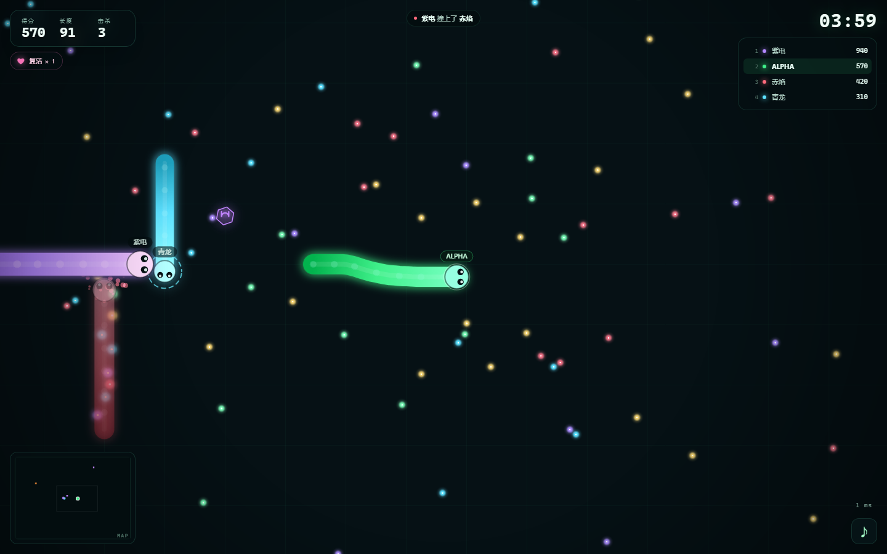
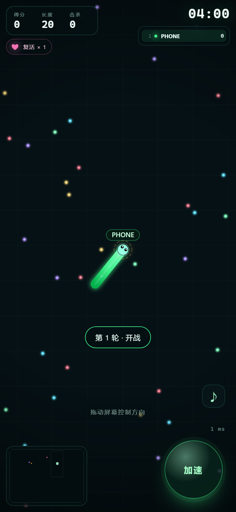
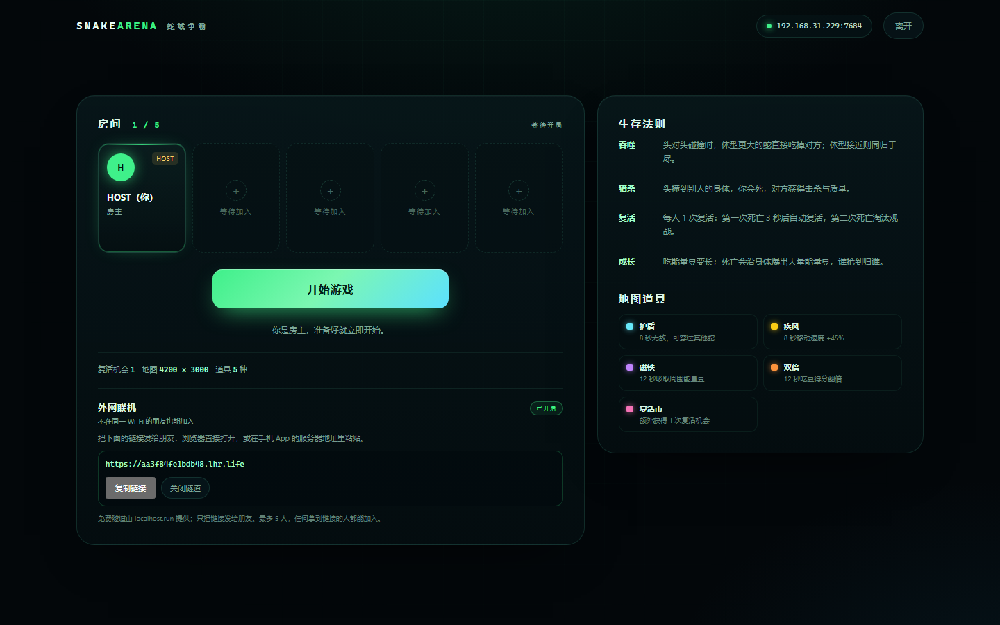
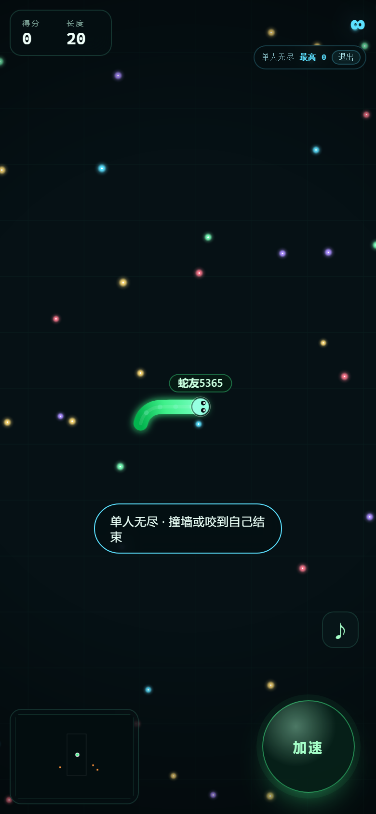
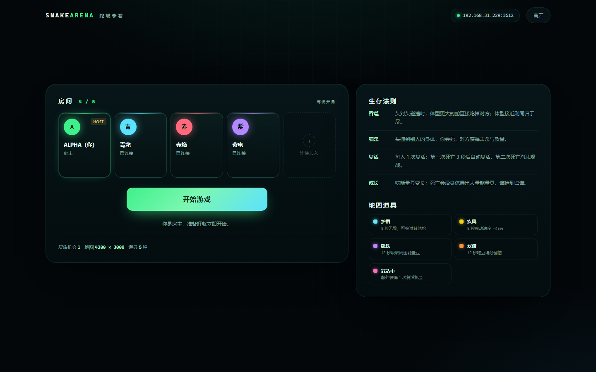
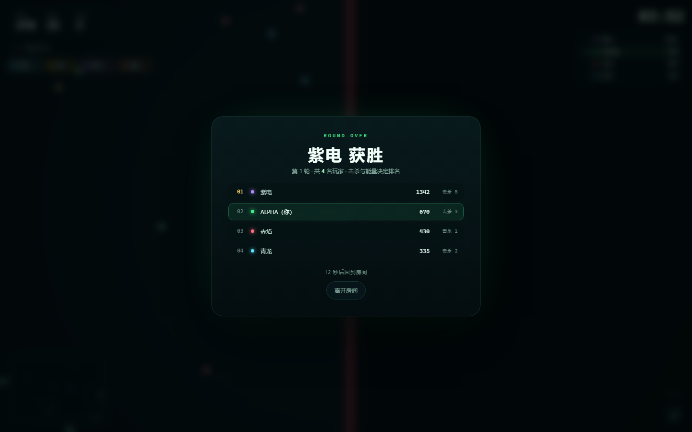

# 蛇域争霸 · SNAKE ARENA

5 人实时贪吃蛇竞技场：**大战场、互相吞噬、一次复活、道具乱斗**。
另外提供**单人无尽**：不需要服务器，浏览器、Windows、Android 三端离线可玩。
房主用 Windows 桌面版开服；同一 Wi-Fi 直接加入，外网朋友也能通过大厅里一键生成的公网链接加入。





---

## 直接下载

| 平台 | 文件 | 说明 |
| --- | --- | --- |
| **Windows 10/11** | [SnakeArena-Windows.zip](dist/SnakeArena-Windows.zip) | 解压后双击 `SnakeArena.exe`；自带 Node 服务器 + WebView2 原生窗口，无需安装其他运行库 |
| **Android 7.0+** | [SnakeArena.apk](dist/SnakeArena.apk) | 客户端：填房主的局域网地址或公网 `https://` 链接加入 |
| **浏览器 / 源码** | `node server.js` | 房主电脑也可以直接用浏览器开服；同一 Wi-Fi 或公网链接都能进 |

> Windows 版未做商业代码签名，SmartScreen 可能提示「Windows 已保护你的电脑」，选择「更多信息」→「仍要运行」即可。

---

## 三端怎么联机

1. **房主**在 Windows 电脑上双击 `SnakeArena.exe`，输入昵称进入房间。
2. 大厅顶部会显示一个地址，例如 `192.168.1.10:31888`。
3. **手机**安装 `SnakeArena.apk`，在「服务器地址」里填写这个地址；
   或者手机 / 其他电脑浏览器直接打开 `http://192.168.1.10:31888`。
4. 最多 5 人。人齐后房主点「开始游戏」。
5. 首次运行如果 Windows 防火墙询问，请允许 `node.exe` 的**专用网络**访问；
   朋友连不上时，优先检查防火墙、是否同一 Wi-Fi、路由器是否开启 AP 隔离。

> 手机 App 是**客户端**，不能自己开服；服务器必须在房主的 Windows 电脑上。
> 桌面窗口关闭后，本次启动的本地服务器会停止。

### 外网联机（不在同一 Wi-Fi）

1. 房主在大厅左侧的「外网联机」区域点 **生成公网地址**。
2. 等待 5–15 秒，出现 `https://xxxx.lhr.life` 后点 **复制链接**。
3. 外网朋友用浏览器直接打开该链接，或在手机 App 的服务器地址里粘贴这个链接。
4. 不需要路由器端口映射，也不要求同一 Wi-Fi；最多仍然是 5 人。



- 隧道由 **localhost.run** 免费提供，房主电脑需要能**出站 SSH（默认 22 端口）**，
  并安装 Windows OpenSSH 客户端（Windows 10/11 通常自带）。
- 链接是**临时且公开**的：任何拿到链接的人都能加入；不用时请点「关闭隧道」。
- 延迟取决于房主与外网朋友的线路，免费服务也可能限速或断开；适合朋友娱乐，
  不适合高强度竞技。
- 房主关闭桌面窗口 / 程序时，隧道会一并关闭。

---

## 玩法

- **地图**：4200 × 3000，4 分钟一局，最多 5 人。
- **移动**：鼠标 / 手指控制方向；按住左键或空格加速。加速会消耗长度，并在身后掉落能量豆。
- **吃豆**：能量豆增加长度与得分；死亡时 55% 的质量沿身体爆成能量豆，谁抢到归谁。
- **吞噬**：
  - 头对头碰撞时，体型大 15% 以上的蛇直接吃掉对方；体型接近则同归于尽。
  - 头撞到别人的身体，**撞的人死**，身体主人获得击杀与 25% 质量。
  - 击杀 +250 分。
- **复活**：每人自带 1 次复活。第一次死亡 3 秒后原位附近重生（带 2.6 秒出生护盾）；
  第二次死亡淘汰，进入观战。复活币道具可额外增加一次。
- **中途加入**：一局开始后再从大厅加入，会立即在安全位置生成（1 条命 + 2.6 秒出生护盾），
  出生方向朝地图中心，不再等到下一轮。
- **单人无尽**：连接页点「单人无尽 · 无需服务器」即可本地开局；吃豆成长，
  撞墙或咬到自己结束，最高分保存在本机。没有倒计时，不依赖局域网/公网。
- **结束**：时间到，或场上只剩一名未淘汰玩家时结算；按得分、击杀、最高长度排名。



### 地图道具

| 道具 | 效果 | 时长 |
| --- | --- | --- |
| 护盾 | 免疫碰撞，可穿过其他蛇 | 8 秒 |
| 疾风 | 移动速度 +45% | 8 秒 |
| 磁铁 | 吸引周围能量豆 | 12 秒 |
| 双倍 | 吃豆得分翻倍 | 12 秒 |
| 复活币 | 额外 +1 次复活（上限 2） | 立即 |

道具最多同时存在 4 个，约每 9 秒刷新一个。

---

## 操作

| 平台 | 转向 | 加速 |
| --- | --- | --- |
| 桌面浏览器 / Windows | 鼠标指向 | 按住鼠标左键 / 空格 |
| 手机 App / 手机浏览器 | 拖动屏幕（虚拟摇杆） | 右下角「加速」按钮 |

> 手机端要**按住屏幕拖动一段距离**才会转向；只点一下不会改变方向。
> 公网隧道延迟可能到 0.5 秒以上，转向会明显滞后；想跟手请用同一 Wi-Fi / 手机热点。

音效开关在连接页底部与游戏画面右下角，点击即可静音 / 恢复。

---

## 截图





---

## 从源码运行

只需要 Node.js 18+（开发时使用 Node 24），**没有任何 npm 依赖**。

```bash
cd snake-arena
node server.js
# 浏览器打开 http://127.0.0.1:3000
```

- 默认端口 3000，若被占用会自动尝试 3001–3011；终端会打印本机 / 局域网地址。
- 同一 Wi-Fi 的手机浏览器打开 `http://<房主IP>:<端口>` 即可，无需安装 App。
- 网页端与服务器同源时自动连接；手机 App 从 `file://` 加载，因此显示「服务器地址」输入框。

### 目录结构

```
snake-arena/
├─ server.js              HTTP 静态服务 + 原生 WebSocket + 房间连接管理
├─ game.js                权威游戏逻辑（移动 / 碰撞 / 吞噬 / 复活 / 道具 / 回合）
├─ tunnel.js              外网联机：本机 SSH → localhost.run 免费隧道
├─ public/                桌面与手机共用的网页客户端
│  ├─ index.html
│  ├─ app.js
│  ├─ style.css
│  └─ icon-*.png / manifest.webmanifest
├─ desktop/
│  ├─ launcher.cs         Windows 启动器（WinForms + WebView2）
│  ├─ launcher.ico
│  ├─ webview2/           WebView2 SDK 托管 DLL + Loader
│  ├─ build-windows.ps1
│  └─ README-Windows.txt
├─ mobile/
│  ├─ src/.../MainActivity.java   Android WebView 外壳
│  ├─ AndroidManifest.xml
│  ├─ res/mipmap-*/ic_launcher.png
│  ├─ snake-arena.keystore         演示签名密钥
│  └─ build-apk.ps1
├─ tests/                 单元 / 集成 / 无头浏览器 E2E
├─ docs/                  预览截图
└─ dist/                  交付物：Windows zip、APK
```

---

## 测试与验证

```bash
npm test          # 15 个游戏逻辑测试 + 4 个服务器集成测试
npm run solo-check # 单人无尽：开局、触摸转向、死亡结算、重开与退出
npm run touch-check # 多人手机端触摸转向 + 空格加速回归
npm run ui-check  # 无头 Edge：4 名玩家、开始、死亡、复活、道具、手机尺寸、结算
npm run file-check # 以 file://（等同 APK 资源路径）连接服务器并开局
npm run tunnel-check # 真实启动公网隧道，验证 API / HTTP / WSS / Host 限制
npm run wan-check    # 房主公网隧道 → 公网浏览器 + file:// 手机 → 3 人开局并渲染
```

> 无头测试需要 Windows + Edge；可先用 `$env:EDGE_PATH = "C:\Program Files (x86)\Microsoft\Edge\Application\msedge.exe"` 指定浏览器。

已验证：

- 房间上限 5 人、房主转移、开局倒计时；
- 吃豆、成长、撞墙、头对头吞噬、头撞身体、护盾免碰撞；
- 第一次死亡自动复活、第二次死亡淘汰、复活币叠加；
- 对局中后加入立即生成并可用手机触摸转向；出生方向朝地图中心，避免出生即撞墙；
- 5 种道具、加速掉豆、回合结算与排名；
- 4 名玩家同局（1 个浏览器 + 3 个协议客户端）；桌面 / 手机 HUD；死亡、复活、结算界面；
- 手机 `file://` 资源加载、服务器地址输入、WebSocket 连接、开局；
- **单人无尽**：`file://` + 手机尺寸下无服务器开局、触摸转向、撞墙结算、
  再来一局、退出返回联机；HUD 显示 `∞` 和本地最高分，无 JS 报错；
- **操作回归**：多人手机端触摸后服务端目标角度归零、空格键 `wantBoost` 为真；
  桌面 4 人 E2E 的鼠标转向/死亡/复活/结算保持原行为；
- **外网联机**：房主一键生成 `https://*.lhr.life`；公网浏览器与 `file://` 手机 App
  同时通过隧道加入（3 人），开始游戏后公网页面正常渲染 HUD / 小地图 / 排行榜；
  隧道管理 API 只允许房主本机 Host，外部请求返回 403；停止隧道后 API 回到 idle；
- Windows WebView2 启动器自动开服、加载页面、关闭时结束服务器进程树；
- APK 使用 Android 35 编译、minSdk 24、v2/v3 签名校验通过。

> 当前环境没有可用的 Android 真机 / 模拟器，因此 APK **未做真机安装测试**；
> 其网页资源与连接流程已用与 APK 完全相同的 `file://` 方式和移动端尺寸跑通。

---

## 构建

### Windows 便携版

要求：Windows 10/11、.NET Framework 4.8 自带的 `csc.exe`、Node.js、`desktop/webview2` 下的 WebView2 SDK DLL。

```powershell
powershell -ExecutionPolicy Bypass -File desktop/build-windows.ps1
# 输出 dist/SnakeArena-Windows.zip
```

### Android APK

要求：JDK 17、Android SDK `platforms;android-35` + `build-tools;35.0.0`、Python。仓库的 `tools/` 中已准备好本机工具链。

```powershell
powershell -ExecutionPolicy Bypass -File mobile/build-apk.ps1
# 输出 dist/SnakeArena.apk
```

APK 使用 `mobile/snake-arena.keystore` 演示密钥签名（口令 `snakearena`）。正式发布请替换为你自己的 keystore，否则无法覆盖安装其他签名的版本。

---

## 常见问题

**朋友输地址后一直连不上？**
- 确认在同一 Wi-Fi / 局域网；
- Windows 防火墙允许 `node.exe`（专用网络）；
- 用大厅顶部显示的**完整地址**，端口可能不是 31888（被占用时会自动 +1）；
- 路由器若开了「AP 隔离 / 客户端隔离」，设备之间不能互访，需要关闭；
- 公司/校园网可能禁止设备互访，换手机热点试试。

**手机 App 能开服吗？**
不能。App 是客户端，服务器运行在房主的 Windows 电脑上。

**关闭游戏窗口后朋友掉线？**
桌面版关闭窗口时会停止本次启动的服务器，这是预期行为；再次打开会重新开服。

**Windows 提示缺少 WebView2？**
安装 Microsoft Edge WebView2 Evergreen Runtime 后重试（Windows 10/11 通常已自带）。

**端口被占用？**
启动器会自动尝试 31889–31899，以大厅实际显示为准；源码模式默认 3000–3011。

**「生成公网地址」失败？**
- 需要 Windows OpenSSH 客户端：设置 → 系统 → 可选功能 → 添加「OpenSSH 客户端」；
- 房主网络需允许出站 SSH 22 端口；公司/校园网常会拦截，换手机热点试试；
- localhost.run 是免费公共服务，偶尔会限速/不可用，稍后重试或缩小使用人群；
- 详细错误会显示在大厅的「外网联机」区域。

**外网链接打不开 / 朋友掉线？**
- 链接只在本次隧道运行期间有效，且需要房主保持桌面窗口打开；
- 关闭隧道后需重新生成，链接会变化；
- 免费隧道延迟较高或被限速时，换网络/重开隧道；
- 链接是公开的，任何人拿到都能加入，建议只私发给朋友，用完关闭。

---

## 已知边界

- 支持局域网直连和 localhost.run 免费公网隧道；没有账号、房间密码、聊天或公网匹配大厅。
- 公网隧道依赖房主出站 SSH 与第三方免费服务，链接临时、公开、可能限速/断开；
  不适合高强度竞技。局域网传输为明文 `ws://`，公网链接走 `wss://`。
- 每局最多 5 人；房主必须保持桌面窗口打开。
- APK 是演示签名；桌面启动器未做代码签名。
- 手机 App 最低 Android 7，建议 Android 8+ 并使用较新的 WebView。

---

## License

MIT（代码与生成素材）。祝玩得开心。
# Snake-Arena

